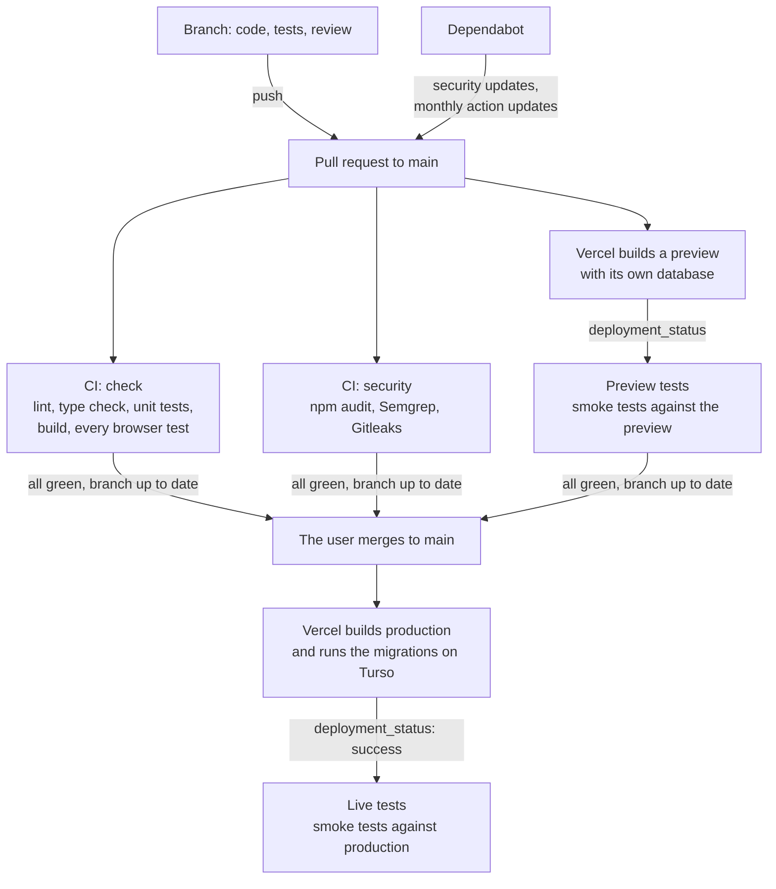

# Playbook: how we build a site

How a site is built, tested, reviewed, documented and published, taken from the project Gurras Flyg (October 2026) and made general. It is meant to start a new project the same way: put it in an empty project folder with the files next to it, and let Claude Code set the project up from it.

## Kom igång (för dig)

1. Den här mappen innehåller redan mallarna, arbetsflödena, granskaren, skills och testinfrastrukturen på rätt plats (se [Vad som finns i mappen](#what-is-in-the-folder)).
2. Öppna Claude Code i mappen och skriv: **"Läs PLAYBOOK.md och sätt upp projektet enligt den, ett steg i taget med mig."**
3. Claude går igenom [Setting up a new project](#setting-up-a-new-project) med dig. En del steg gör du själv i webbläsaren (konton, hemligheter och inställningar i GitHub, Vercel och Turso); Claude säger vilka.
4. Därefter följer varje ändring arbetsflödet i `CLAUDE.md`: kort, specificera, bygga, testa, verifiera, dokumentera, granska och merge.

Two names to choose at the start: the product's name (here **Muppbarnen**) and the prefix of feature IDs (here **`MUPP-`**; technical tasks are always `TECH-`). They are already filled in throughout the files; change them with a search and replace if you want others.

---

## What is in the folder

| Path | What | Change it? |
|---|---|---|
| `PLAYBOOK.md` | This file: the whole way of working, and the setup | Keep as the reference |
| `CLAUDE.md` | The instructions Claude Code reads in every session: the workflow, Definition of Done, rules | Fill in the placeholders `<…>` during setup |
| `.claude/agents/code-reviewer.md` | The reviewer agent used in the review step | No |
| `.claude/skills/` and `skills-lock.json` | Design skills: `design-taste-frontend`, `emil-design-eng`, `impeccable` | Update from their sources when wanted |
| `.github/ISSUE_TEMPLATE/card.md` | The template for every card on the board | No |
| `.github/workflows/ci.yml`, `preview-tests.yml`, `live-tests.yml` | CI, smoke tests against the preview and against production | Check the live URL and the Playwright version |
| `.github/actions/setup-tests/action.yml` | The test jobs' shared setup | No |
| `.github/dependabot.yml` | Security updates for npm, monthly updates for Actions | No |
| `.semgrep/sql.yml` | Our own Semgrep rule: SQL joined from text | No |
| `specs/_template/` | `solution.md`, `flow.mmd`, `verification.md`, `review.md` for every card | No |
| `wiki/system/testing.md`, `pipeline.md`, `code-review.md`, `accessibility.md` | The rules for tests, the pipeline, the review and accessibility | Grow with the project |
| `scripts/db-setup.mjs`, `test-server.mjs`, `test-time.mjs`, `postinstall.mjs`, `check-playwright-image.mjs` | Database setup and migrations with backups; the local test server; the timed test run; Playwright install; the image version check | No |
| `lib/db.ts`, `lib/local-db.mjs`, `db/schema.sql`, `db/seed.sql`, `db/migrations/`, `db/test-db.ts` | Database access, where the local databases are, an empty schema, seed and migration folder, and the unit tests' database helper | Fill the schema with the first feature |
| `playwright.config.ts`, `vitest.config.mts`, `vitest.global-setup.mjs`, `tests/helpers.ts`, `tests/global-teardown.ts` | Test configuration and shared test helpers | Add the project's helpers as it grows |
| `next.config.ts`, `eslint.config.mjs`, `.gitignore`, `.env.example` | Next.js settings with security headers, lint, ignores, the environment variables | Merge with what `create-next-app` makes |

---

## How we work

### Specification-driven development (SDD)

- **The requirements are the source of truth.** Every change starts as a card on the GitHub board, with a goal, a scope, numbered requirements (`MUPP-010-R1`, …) with acceptance criteria in Given/When/Then, and a test plan. It is built only when no open questions remain.
- **Code, tests and documentation follow from the requirements.** `specs/<ID>-<name>/solution.md` says how a card is built, each test is named after the requirement it checks, and the manual and the system documentation describe what was built.
- **Every requirement is traceable:** from the card, to its tests, to a row in the card's `verification.md` (how it was checked, where, the result, the date). When the card is done, its requirements are copied into `verification.md` as built.
- **A requirement that turns out wrong is changed in the card first,** together with the product owner (the user), and then in the code. Code and requirements never disagree.

### Roles

- **The user** is the product owner: decides what is built, settles the requirements and open questions, merges pull requests, and does what needs their accounts and secrets.
- **Claude** specifies together with the user, builds, tests, documents, runs the reviews, and keeps the board, the specs and the wiki true. Claude commits only when asked and pushes only when asked.

### The steps for every card

The full text is in `CLAUDE.md`, which is the one place the workflow is maintained. In short:

1. **Specify** the top card in Backlog with the user: goal, scope, requirements with acceptance criteria, test plan, open questions answered. Move it to **Specified**.
2. **Start:** branch `<ID>-<name>`, folder `specs/<ID>-<name>/` from `specs/_template/`, card to **Ongoing**.
3. **Build** exactly what the requirements say, with the unit tests next to the code. Keep `solution.md` current.
4. **Test:** the browser tests and, for a new main page or flow, a smoke test. Every requirement has a test named after it, or a recorded manual check with the reason.
5. **Verify:** fill in `verification.md`; run lint, the type check, the build and `npm run test:time`.
6. **Document:** `wiki/system/` (English), `wiki/manual/` (Swedish), the index pages, `architecture.md` if the structure changed, a line in `wiki/log.md`.
7. **Review:** the reviewer agent, plus `/security-review` when the change touches sign-in, admin, API routes, server actions, database queries or personal data. Save `review.md`; fix every must-fix and run again; give every finding a decision and a reason.
8. **Done:** Definition of Done checked, requirements copied into `verification.md` as built, the feature added to the list in `specs/overview.md`, commit with the ID (`MUPP-007: Önskelista`).
9. **Merge:** push when asked, pull request with "Closes #<card>", card to **Review**, `review.md` posted as a comment. The checks must be green and the branch up to date; the user merges. Live tests run after the deploy; then the accessibility checklist on the live site.

Small fixes that don't change behaviour (typos, styling details) need no card, but the cards, the specs and the wiki are kept true.

### Definition of Done

Tests (every check in the test plan, every requirement tested, unit and local browser tests pass, smoke tests pass against production after the deploy); accessibility (axe on every new page and state, the checklist on the live site per item); requirements match what was built; manual, system docs and log updated; no leftovers; clean code (lint, type check, build without warnings, shared components reused); code review done with no must-fix left; improvements handled; the test suite's numbers before and after recorded and within budget. The exact list is in `CLAUDE.md`.

### Technical tasks

Improvements that don't change what the site does (leftovers, duplicated code, shared components, speed). Small and related: fixed in the same change, mentioned in the commit and `verification.md`. Large or unrelated: a card with Work type **Tech** and ID `TECH-001`, …, grouped so the board doesn't fill up. They go through the same steps and Definition of Done; their requirements are usually "the site behaves as before" plus the concrete change.

### How Claude and the user work together

Learned in Gurras Flyg; keep them unless the user says otherwise:

- **Answer in Swedish** in the chat; files follow the language rules below.
- **Specify only a few cards ahead,** then build; specs written far ahead go stale.
- **One card per session.** A whole card in one long conversation costs many tokens: start a new session per card, read only what each step needs, run only the card's test file while working and the whole suite once at the end.
- **Commit only when asked, push only when asked,** check the staged files before every commit, never push to `main`.
- **Push everything before the checks go green:** the user merges as soon as the pull request's checks pass, so nothing may be left to push after.
- **After a push,** offer Auto-fix on the pull request instead of polling CI.
- **Explain briefly** when a choice is worth learning from (a pattern, a trade-off, why something was refactored). The project is also a learning project.

### Code quality

Tidy, consistent and easy to follow: clear names, small functions, shared components instead of copies, comments that explain why. Prefer the simple solution over the clever one. Read the code around a change and write like it.

### Languages

- Specifications, system documentation (`wiki/system/`), README, `CLAUDE.md`, this playbook: **English**.
- The user manual (`wiki/manual/`) and everything visitors see: **Swedish**.
- Code comments: **Swedish**.

---

## The backlog on GitHub

The backlog is a **GitHub Project** (board) in the user's account, linked to the repository. The cards are issues.

- **Columns** (the field Status): **Backlog**, **Specified**, **Ongoing**, **Review**, **Done**. The order of the cards in Backlog is the priority: the top card is next.
- **Fields:** **Work type** (single select: Feature, Fix, Tech) and **Area** (single select: the product's areas, plus Administration and Shared).
- **IDs:** a card gets its ID when it is created and the ID starts its title: `MUPP-001 Short name` for Feature and Fix, `TECH-001 Short name` for Tech. Requirements are `<ID>-R1`, `<ID>-R2`, …
- **Template:** `.github/ISSUE_TEMPLATE/card.md`: a short explanation, then Goal, Background, Users, Scope (in and out), Requirements with acceptance criteria, Test plan (unit tests, browser tests, smoke test, accessibility, security, code review), Non-functional requirements and Open questions.
- **The board's built-in workflows** (Project → Workflows): "Item closed" and "Pull request merged" set Status to Done, so a merged pull request with "Closes #<card>" moves its card.
- **With the GitHub CLI** (`gh`, signed in with the `project` scope: `gh auth refresh -s project`):
  - read a card: `gh issue view <number>`
  - create one: `gh issue create --title "MUPP-012 …" --body-file <file>`, then `gh project item-add <project number> --owner <user> --url <issue url>`
  - the field and option ids: `gh project field-list <project number> --owner <user> --format json`
  - move a card or set a field: `gh project item-edit --project-id <id> --id <item id> --field-id <field id> --single-select-option-id <option id>`
  - put a card first: GraphQL `updateProjectV2ItemPosition` without `afterId`.

The issue number (`#16`) and the ID (`MUPP-011`) differ; the ID is what specs, branches, tests and commits use.

---

## Git and GitHub

- **One branch per card,** named after its folder: `MUPP-010-wishlist`. Commit messages start with the ID; Swedish text is fine (`MUPP-010: Önskelista`).
- **Pull requests to `main`** with "Closes #<card>" and a short what and checks; the review report posted as a comment (`gh pr comment <url> --body-file specs/<ID>-<name>/review.md`).
- **Branch protection on `main`** (free for a public repository): changes only through pull requests; direct and force pushes refused; required checks `check`, `security` (CI), `preview` (Preview tests) and `Vercel`; the branch must be up to date with `main`; no approving review required when there is one developer.
- **The repository is public** (needed for free branch protection), so nothing secret is ever committed: `.env*` is ignored, Gitleaks scans the history.
- **Attribution:** Claude's commits end with its `Co-Authored-By` line, and its pull request descriptions with the Claude Code line.

---

## Architecture

| Part | Choice |
|---|---|
| Framework | **Next.js 16** (App Router, TypeScript, React 19), pages and server code in one project. This Next.js differs from older ones: read `node_modules/next/dist/docs/` before writing code (`AGENTS.md`, written by `next dev`). |
| Styling | **Tailwind CSS 4** with the design's tokens in `app/globals.css`, and shared components in `app/components/` (described in `DESIGN.md`). |
| Data in pages | Server components read data. With `cacheComponents` on, data that depends on the request (database, clock, cookies) is read after `await connection()` or inside `<Suspense>`. |
| Changes | Server actions, which check sign-in and input on the server, call `lib/`, and refresh the page. Errors meant for the user are thrown as their own error class and shown as messages. |
| Server code | `lib/`, with `import "server-only"` in files that touch the database or secrets. Pure rules (dates, validation) live in files without it, so the browser and the server share them and unit tests can import them. |
| Database | **SQLite through `@libsql/client`**: the same SQL locally and in production. `lib/db.ts` has `all`, `get`, `run`, `withTransaction` (a write transaction, retried while the database is busy), `constraintKind` and `escapeLike`. Every value goes in as a parameter (`?`). |
| Hosting | **Vercel**: a push to `main` publishes production; every pull request gets a preview. |
| Production database | **Turso** (hosted libSQL), one database for Production and a separate one for Preview. |

### Databases and environments

| Environment | Database |
|---|---|
| Local | A file outside the project folder, `~/Ai Projekt/muppbarnen-data/muppbarnen.db` (`lib/local-db.mjs`), so it survives a fresh clone. It is the user's own data: never reset it, delete from it or write test data to it; experiments run on a copy (`TURSO_DATABASE_URL=file:<copy>`). |
| Local backups | `db/backups/` in the project, local only and not in Git: one every time `npm run dev` starts, before migrations and before `npm run db:reset`; the 20 newest are kept. Written to a temporary name and renamed when complete. |
| Unit tests | `~/Ai Projekt/muppbarnen-data/unit-test.db`, rebuilt from schema, seed and migrations before every run. |
| Local browser tests | `~/Ai Projekt/muppbarnen-data/test.db`, rebuilt every `npm run test:local`. One run at a time per computer. |
| Production | Turso, with `TURSO_DATABASE_URL` and `TURSO_AUTH_TOKEN` added **by hand** in Vercel's environment variables for Production. |
| Preview | A separate Turso database connected through Vercel → Storage **to Preview only**. Never connect the integration to Production too: it and the hand-made variables would fight over the same names. |

On Vercel the build stops if `TURSO_DATABASE_URL` is missing, so the site can't silently run against a temporary file. `npm run db:reset` refuses to run against Turso.

### Schema changes

A new database is built from `db/schema.sql` and `db/seed.sql`; every later change is a numbered migration `db/migrations/NNN_<name>.sql`, run once per database (recorded in `schema_migrations`) by `scripts/db-setup.mjs` before `npm run dev` and `npm run build`. So a deploy migrates Turso. **Never edit an applied migration;** add a new one. A migration that is not yet merged (has run nowhere but test databases) may still be changed. Large generated data comes from a script with a fixed seed, with a unit test that regenerates it and compares.

### Admin and sign-in (when the site has an admin)

- One shared password, `ADMIN_PASSWORD`; the server sets a cookie with an expiry and an HMAC-SHA256 signature made with `ADMIN_SESSION_SECRET`: `HttpOnly`, `Secure` in production, `SameSite`, lasting until the browser closes and rejected after 8 hours.
- Passwords compared as SHA-256 hashes with `timingSafeEqual`; a wrong password answered after a second; at most 5 attempts per IP address in 15 minutes, counted in a database table before the password is checked (on Vercel each request may run in a new function).
- `proxy.ts` checks the cookie before admin pages, and every server action checks it again; server actions check their input at run time (ids integers, texts strings of limited length, lists arrays).

### Security headers

`next.config.ts` sends on every response: `X-Frame-Options: DENY`, `Content-Security-Policy: frame-ancestors 'none'`, `X-Content-Type-Options: nosniff`, `Referrer-Policy: strict-origin-when-cross-origin`.

### Environment variables

`.env.local` locally (never committed or printed), Vercel's environment variables for Preview and Production, `.env.turso` only for running migrations against Turso by hand (`npm run db:turso`). `.env.example` lists them.

### package.json

```json
"scripts": {
  "predev": "node scripts/db-setup.mjs --backup",
  "dev": "next dev",
  "prebuild": "node scripts/db-setup.mjs",
  "build": "next build",
  "start": "next start",
  "lint": "eslint",
  "typecheck": "next typegen && tsc --noEmit",
  "db:reset": "node scripts/db-setup.mjs --reset",
  "db:turso": "node --env-file=.env.turso scripts/db-setup.mjs",
  "db:backup": "node scripts/db-setup.mjs --backup",
  "postinstall": "node scripts/postinstall.mjs",
  "test": "playwright test",
  "test:local": "BASE_URL=http://localhost:3100 playwright test",
  "test:smoke": "playwright test --grep @smoke",
  "test:unit": "vitest run",
  "test:time": "node scripts/test-time.mjs"
}
```

Dependencies: `next`, `react`, `react-dom`, `@libsql/client`, `server-only`. Dev dependencies: `typescript`, `@types/node`, `@types/react`, `@types/react-dom`, `eslint`, `eslint-config-next`, `tailwindcss`, `@tailwindcss/turbopack`, `@playwright/test`, `@axe-core/playwright`, `vitest`. Node.js 24.

---

## The pipeline



- **The whole suite runs once,** in CI on the pull request, against a local production build with its own fresh database. The preview and production get only the read-only smoke tests, so production never gets test data and no test uses a production secret. CI doesn't run again on `main`: the branch had to be up to date.
- **`deployment_status`** (turned on in Vercel → Settings → Git) starts Preview tests and Live tests when Vercel reports a deployment; the run belongs to the deployed commit, so it shows on the pull request. Preview tests also fails when the deploy failed. A skipped `live` check on pull requests is expected.
- **Previews are behind Vercel's sign-in.** Preview tests sends `VERCEL_AUTOMATION_BYPASS_SECRET` (Vercel → Settings → Deployment Protection → Protection Bypass for Automation), a repository secret, as a header.
- **CI makes up a throw-away admin password** for its test server; no real secret is used in CI.
- **The test jobs run in Playwright's image** `mcr.microsoft.com/playwright:v<version>-noble`; the shared setup stops the job if its version differs from `@playwright/test`. Update the image version in the three workflows when Playwright is updated.
- **Every third-party action is pinned to a commit** with its version as a comment; `GITHUB_TOKEN` can only read; secrets go only to the step that needs them.
- **Failed runs** save Playwright's report with screenshots as an artifact; traces only locally (they contain typed values and headers).
- **A newer push cancels the older run.**

More in `wiki/system/pipeline.md`.

---

## Testing

The full rules are in `wiki/system/testing.md`; the essentials:

| Check | What | Runs | Passes when |
|---|---|---|---|
| Unit tests (Vitest) | Logic, calculations, rules, data and migrations | Locally (`npm run test:unit`, watch mode), in CI before the build | All pass |
| Browser tests (Playwright) | What a visitor or the administrator sees and does, keyboard, focus, the look | Locally (`npm run test:local`), in CI | All pass, none retried |
| Smoke tests (`@smoke`) | That a deployed site works: main pages and flows answer; read-only | Against the preview and production after each deploy | All pass |
| Accessibility | WCAG 2.2 AA: axe in the browser tests, the manual checklist on the live site | Tests; by hand | No violations; every relevant item passes |
| Security | Review points, `/security-review`, scans | Review; CI job `security`; Dependabot | Nothing must-fix left |
| Code review | What tools can't see | Review step | No must-fix left |

- **Which kind:** a rule or calculation is a unit test with as many cases as it needs, and one or two browser tests show that the page uses it. The browser tests what only a browser can show.
- **Names:** every test is named after the requirement(s) it checks: `test("MUPP-007-R2 shows only the chosen date", …)`; a combined test lists them all (`MUPP-004-R1 R2 R7 …`). One browser test file per card, `tests/<ID>-<name>.spec.ts`; unit tests next to the code as `<file>.test.ts`; the look in one file, `tests/design.spec.ts`, one test per page and state.
- **Test data:** named with `uniqueName()` ("E2E …") and deleted by the test; a worker-scoped fixture creates shared test data once (only for the tests that ask for it, so smoke tests stay read-only); `tests/global-teardown.ts` removes leftovers. Tests that change shared data irreversibly or read the database directly run only when `runsLocally`.
- **Quality rules:** no retries and no flaky tests; no fixed waits (wait for what the user sees); tests check behaviour, not only markup; no duplicates (except smoke tests); shared helpers; combine by journey (tests reaching the same state are one test that goes on).
- **Time budgets:** one test at most 5 s locally; all unit tests at most 30 s; all local browser tests at most 3 min (without the build); smoke tests against a deployed site at most 1 min; CI job at most 8 min (2 min preparation), Preview and Live tests at most 2 min. `npm run test:time` prints the numbers and the five slowest; every card records before and after; over budget or more than 25 % growth in one change means find the cause or put a TECH card at the top.
- **A failing test** is a bug in the site (tell the user) or a wrong test (fix it, and the requirement if needed). Never weaken a test to make it pass.
- **`npm test` runs against the live site by default.** Run new tests locally first, with `npm run test:local` or `BASE_URL=http://localhost:3100 npx playwright test <file>`.

---

## Accessibility

The site meets **WCAG 2.2 level AA**. `expectNoA11yViolations(page)` in `tests/helpers.ts` runs axe (WCAG 2.0/2.1/2.2 A and AA) on each page and state a card adds or changes. Tools find roughly a third of the problems, so a card that changes what people see also goes through the manual checklist in `wiki/system/accessibility.md` on the live site after the deploy, and records each item (keyboard only, visible focus, VoiceOver, 200 % zoom and 320 px, text spacing, contrast of text and of borders, focus ring and icons, 24 px targets, hover/focus content, errors and labels, page title and language and alt texts, reduced motion). Anything below AA is fixed in the same card.

---

## Security

- **In the code review** (`wiki/system/code-review.md`): sign-in checked on the server for every admin page, server action and API route; input validated on the server; parameterised queries; secrets out of code, the browser, logs and error messages; secure cookies; errors that say what to do without internals; personal data shown only to the right person; actions pinned to commits. Breaking one is must-fix.
- **`/security-review`** (Claude Code) for every change touching sign-in, admin, API routes, server actions, database queries or personal data; its high findings are must-fix and its result goes into `review.md`.
- **In CI** (job `security`): `npm audit --omit=dev --audit-level=high`; Semgrep with the community rules for JavaScript, TypeScript, React, Next.js and SQL injection plus our rule in `.semgrep/sql.yml`; Gitleaks over the whole history. A wrong Semgrep finding is marked on its line with `// nosemgrep: <rule>` and a comment why.
- **Dependabot:** npm security updates; monthly grouped updates of the pinned Actions.
- **A leaked secret is rotated first;** removing it from Git doesn't make it secret again.

---

## Code review

The reviewer agent (`.claude/agents/code-reviewer.md`) starts without the author's context, reads the card's requirements, `solution.md` and the change (commits, uncommitted changes and new files), and follows `wiki/system/code-review.md`: general errors, requirements and their tests, design, duplicated and unnecessary code, test quality, project rules, security. Findings have three levels: **must fix** (blocks; fix and run again), **should fix** (fix now when small, otherwise a TECH card), **suggestion** (at most three; fix when cheap). Every finding gets a decision and a reason in `review.md`, which is posted on the pull request. If the review stopped the card, tell the user in a few lines what it found and how it was fixed.

---

## Documentation

| Where | What | Language |
|---|---|---|
| The card | What and why: requirements, test plan | English |
| `specs/overview.md` | The product: purpose, users, terms, scope, the list of features (ID, what, area, status), rules for all features, "How we work" | English |
| `specs/<ID>-<name>/` | `solution.md` (data, interface, decisions and why), `flow.mmd` (Mermaid flow), `verification.md` (how each requirement was checked, the test suite before and after, Definition of Done, the requirements as built), `review.md` | English |
| `wiki/system/` | How the site works: architecture, pipeline, testing, code review, accessibility, one page per feature or part | English |
| `wiki/manual/` | How to use the site, for visitors and administrators | Swedish |
| `wiki/log.md` | One line per finished card, newest first | English |
| `wiki/index.md`, `wiki/system/index.md`, `wiki/manual/index.md` | Index pages, updated with every new page | |
| `README.md` | Layout, getting started, conventions | English |
| `DESIGN.md`, `PRODUCT.md` | The design (tokens, components, rules) and the product's voice, used by the design skills | English |

Every wiki page starts with frontmatter, so the wiki can later feed a chatbot:

```yaml
---
type: Guide | Feature | Index | Log
title: …
description: One sentence.
resource: the main file or folder
feature: <ID>
tags: [ … ]
timestamp: YYYY-MM-DD
---
```

`verification.md` records only checks that were actually done; anything not checked is written as not checked.

---

## Skills and tools

| What | Where | Used for |
|---|---|---|
| `design-taste-frontend` | `.claude/skills/`, source `leonxlnx/taste-skill` | Art direction and a no-slop house style for pages and app screens |
| `emil-design-eng` | `.claude/skills/`, source `emilkowalski/skills` | UI polish, components and animation decisions |
| `impeccable` | `.claude/skills/`, source `pbakaus/impeccable` | Design, critique, audit and polish of interfaces; writes `DESIGN.md` and `PRODUCT.md` |
| `code-reviewer` agent | `.claude/agents/code-reviewer.md` | The review step |
| `/security-review` | Built into Claude Code | Security review in the review step |
| `/code-review` | Built into Claude Code | Optional extra bug review |
| GitHub CLI (`gh`) | Installed locally, signed in with the `project` scope | Cards, the board, pull requests, comments, workflow runs |
| Vercel | vercel.com, connected to the GitHub repository | Previews and production |
| Turso | turso.tech (and its CLI, optional) | The production and preview databases |
| Playwright, Vitest, axe | npm | Tests |

`skills-lock.json` records each skill's source and hash, so they can be updated from their sources.

---

## Setting up a new project

Claude does these with the user, in order, and says which the user must do in a browser. Record what was done in a first card, `TECH-001 Project setup`, with its own folder and `verification.md`.

1. **Accounts and tools (the user):** GitHub, Vercel and Turso accounts; Node.js 24; Git; `gh` installed and signed in (`gh auth login`, then `gh auth refresh -s project`).
2. **The Next.js project:** `npx create-next-app@latest` in this folder (TypeScript, Tailwind, App Router, ESLint), keeping the files of this kit; merge `next.config.ts`, `eslint.config.mjs` and `.gitignore` with what it made; add the scripts and dependencies above; `npm install`; turn on `cacheComponents` and read `node_modules/next/dist/docs/`.
3. **Local setup:** copy `.env.example` to `.env.local` and fill in the values; `npm run dev` creates the local database outside the folder; check that `npm run lint`, `npm run typecheck`, `npm run test:unit` and `npm run build` pass.
4. **First pages and tests:** a start page, `tests/smoke.spec.ts` with a first `@smoke` test, `tests/design.spec.ts` when the design arrives, `app/components/` for the shared components, `specs/overview.md` and `README.md` for the product, the wiki index pages and `wiki/log.md`.
5. **GitHub repository (public)** and the first push of `main` (the only direct push; after branch protection everything goes through pull requests).
6. **The board (the user, with Claude's help):** a new Project linked to the repository; Status with Backlog, Specified, Ongoing, Review, Done; fields Work type and Area; the built-in workflows that set Done; fill in `<board URL>` and the areas in `CLAUDE.md`.
7. **Vercel (the user):** import the repository; Settings → Git: turn on `deployment_status` events; Settings → Deployment Protection → create the Protection Bypass for Automation secret, and add it as the GitHub repository secret `VERCEL_AUTOMATION_BYPASS_SECRET`; put the production URL in `playwright.config.ts`, `.github/workflows/live-tests.yml` and `wiki/system/pipeline.md`.
8. **Turso (the user):** one database for Production, its URL and token added by hand in Vercel's environment variables for Production only; one for Preview through Vercel → Storage, connected to Preview only; admin secrets (if any) for both.
9. **Branch protection on `main`** (the user, or `gh api`): pull requests only, required checks `check`, `security`, `preview` and `Vercel`, branch up to date, no force pushes or deletion.
10. **Check the pipeline** with a first pull request: CI, Preview tests, the merge, Live tests.
11. **Design (optional, with the skills):** `impeccable` or `design-taste-frontend` to settle the look; `DESIGN.md` and `PRODUCT.md`; tokens in `app/globals.css`.
12. **The first cards:** write the backlog with the user (a few cards specified ahead), and start the workflow in `CLAUDE.md` with the top card.

---

## Lessons from Gurras Flyg

Pitfalls met once, so they needn't be met again:

- **Never run `npm run build` while `npm run dev` is running** in the same folder: the dev server loses its CSS. Restart dev after building; the test server builds into `.next-test/` for this reason.
- **Vercel can serve old CSS from its build cache** after a merge; redeploy without the cache.
- **Previews have their own database.** A smoke test that needs data (for example at least one product) fails on a preview whose database lacks it.
- **One test run at a time per computer:** every checkout shares the test database. A second run needs another `HOME`.
- **Next.js has an alert of its own** (the route announcer) outside `<main>`: look for a page's messages inside `main`.
- **A controlled input whose state lives in the address** (`history.replaceState`) isn't checked at once after a click: click and wait for `toBeChecked()` instead of `check()`.
- **A `beforeEach` runs before the test's fixtures:** sign in inside the test when it needs the fixture's data.
- **Elements that fade in confuse axe's contrast check:** wait for animations before running axe (the helper does).
- **Don't run Prettier** unless it is a dependency: it reformats everything to 80 columns.
- **`next dev` rewrites `AGENTS.md` and `tsconfig.json`;** commit `AGENTS.md` with the work, and revert unrelated `tsconfig.json` changes.
- **Long sessions burn tokens:** a whole card, two review agents and repeated full test runs in one conversation add up. A new session per card is cheaper.
